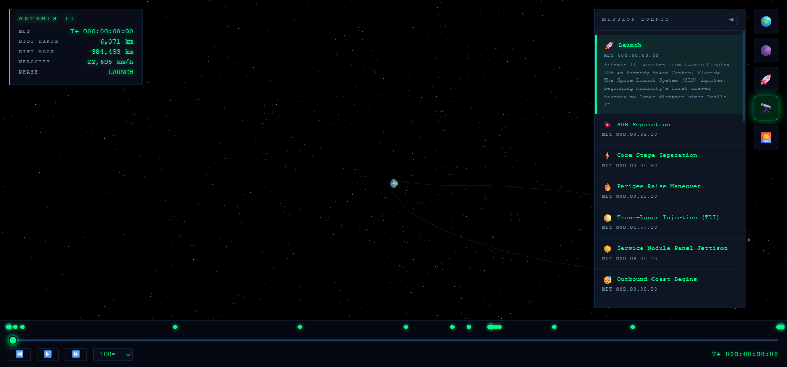
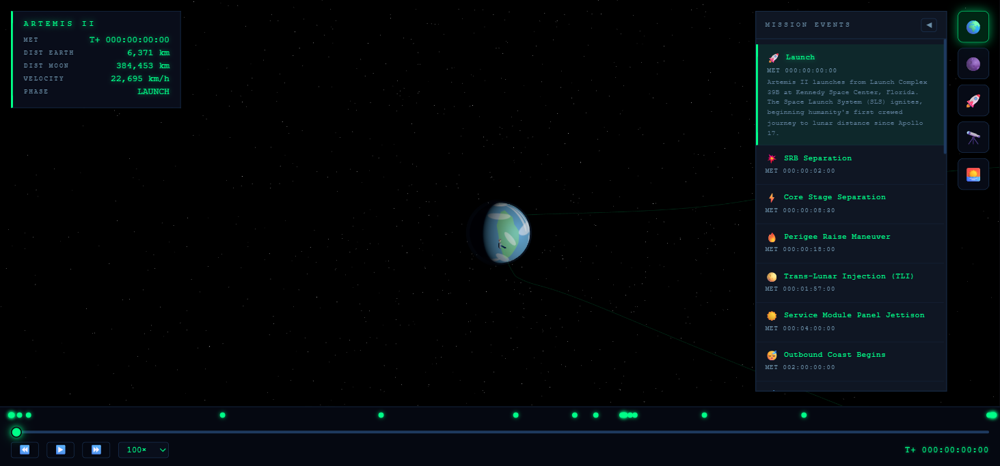

# Artemis II Mission Tracker

Simulador 3D interactivo de la misión **Artemis II** de la NASA: el primer viaje tripulado a
distancia lunar desde el Apollo 17. Orion despegó el 1 de abril de 2026 desde el Centro Espacial
Kennedy con cuatro astronautas, en una trayectoria de retorno libre de 9 días alrededor de la Luna.

El simulador reproduce la misión completa —del lanzamiento al amerizaje— sobre una escena Three.js
con la Tierra, la Luna y Orion, una línea de tiempo navegable, telemetría en vivo, los 26 eventos
clave y un diálogo recreado de la tripulación.



> Las capturas son de una versión anterior, con la interfaz en inglés; hoy la interfaz está en español.

## Requisitos

| Herramienta | Versión |
|-------------|---------|
| Node.js | 20 o superior (probado con 24) |
| npm | el que trae Node |
| Navegador | uno con soporte de WebGL y `importmap` (Chrome, Edge, Firefox o Safari recientes) |

El navegador necesita internet: Three.js, Chart.js y las fuentes se cargan desde CDN.

## Cómo ejecutarlo

```bash
git clone https://github.com/crisXD96/artemis-ii-mission-tracker.git
cd artemis-ii-mission-tracker
npm install
npm run dev
```

Abre **http://localhost:3000** en el navegador.

### Scripts

| Comando | Qué hace |
|---------|----------|
| `npm run dev` | Servidor de desarrollo con recarga automática (`tsx watch`) |
| `npm test` | Corre los tests con Vitest (53 tests) |
| `npm run build` | Compila TypeScript a `dist/` |
| `npm start` | Corre la versión compilada (`node dist/server.js`); antes hay que correr `npm run build` |

### Cambiar el puerto

El servidor usa la variable de entorno `PORT` (3000 por defecto):

```bash
# bash / macOS / Linux
PORT=8080 npm run dev
```

```powershell
# PowerShell
$env:PORT = 8080; npm run dev
```

## Cómo se usa

| Control | Acción |
|---------|--------|
| Arrastrar | Girar la escena |
| Rueda del mouse | Acercar o alejar |
| Botón derecho | Desplazar la vista |
| Clic en Orion | Ver a la tripulación |
| ▶ | Reproducir o pausar la misión |
| −12 h / +12 h | Saltar medio día |
| 1× a 1000× | Velocidad de reproducción |
| Marca en la línea de tiempo | Ir al momento de ese evento |
| Botones de la esquina superior derecha | Vistas de cámara: Tierra, Luna, seguir a Orion, general y salida de la Tierra |



## Estructura del proyecto

```
├── src/                     # Backend (Express + TypeScript)
│   ├── server.ts            # Servidor, archivos estáticos y rutas de la API
│   ├── types.ts             # Interfaces compartidas
│   ├── lib/
│   │   ├── orbital-math.ts  # MET, interpolación, distancias, fases de misión
│   │   └── trajectory.ts    # Generador de trayectoria (spline Catmull-Rom)
│   ├── data/
│   │   ├── events.ts        # 26 eventos de la misión
│   │   └── crew.ts          # Tripulación
│   └── routes/              # Endpoints /api/*
├── public/                  # Frontend estático (sin build)
│   ├── index.html
│   ├── css/styles.css
│   └── js/
│       ├── app.js           # Escena Three.js, HUD, línea de tiempo
│       └── crew-dialogue.js # Diálogo recreado de la tripulación
├── tests/                   # Tests de Vitest
└── docs/                    # Documentación técnica
```

## API

| Endpoint | Descripción |
|----------|-------------|
| `GET /api/trajectory` | Todos los puntos de la trayectoria con su telemetría |
| `GET /api/events` | Los 26 eventos de la misión |
| `GET /api/events/upcoming?met=N` | Los 3 eventos siguientes a partir del MET `N` (segundos) |
| `GET /api/telemetry/current` | Telemetría simulada del momento actual |
| `GET /api/telemetry/:met` | Telemetría en un MET dado (segundos) |
| `GET /api/crew` | Tripulación |

El detalle de cada respuesta está en [docs/api.md](docs/api.md).

## Documentación

- [Arquitectura](docs/arquitectura.md): cómo encajan backend, frontend, el sistema de coordenadas y el modelo de la trayectoria.
- [API](docs/api.md): referencia de endpoints con ejemplos.
- [Guía de desarrollo](docs/desarrollo.md): flujo de trabajo, tests, cómo agregar eventos y cómo cargar datos reales de la NASA.

## Tripulación

| Nombre | Rol | Agencia |
|--------|-----|---------|
| Reid Wiseman | Comandante | NASA |
| Victor Glover | Piloto | NASA |
| Christina Koch | Especialista de Misión 1 | NASA |
| Jeremy Hansen | Especialista de Misión 2 | CSA |

## Aviso

La trayectoria es una aproximación visual generada con splines, no una solución de mecánica
orbital, y el diálogo de la tripulación es una dramatización, no una transcripción real. Este
proyecto no está afiliado a la NASA ni a la CSA.
